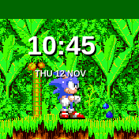

# Sonic 3 Clock

A *Sonic the Hedgehog 3* themed watchface for Bangle.js 2 featuring authentic run, stop, and wait animations against a lush Angel Island Zone background.

## Usage

- **Run:** Sonic runs across Angel Island when the watch is awake and unlocked.
- **Stop:** Sonic skids to a halt when the watch screen locks or goes idle.
- **Wait:** Sonic enters his iconic impatient foot-tapping stance when you twist your wrist to check the time (`Bangle.on("twist")`). This behavior is configurable in settings.

## Configuration

You can access settings either by **double-tapping** the **top** bezel of the touchscreen while unlocked, or via **Settings -> App Settings -> Sonic 3 Clock**.

- `Active Mode`: Disables turning on the LCD on a twist gesture, preventing accidental wakeups during workouts or physical activity.
- `Twist Thresh`: Adjusts the wrist acceleration threshold required to trigger the twist event (see [`Bangle.setOptions`](https://www.espruino.com/Reference#:~:text=twisted%3F%20default%20%3D%20true-,twistThreshold,-How%20much%20acceleration)).

## Credits & Acknowledgements

- **Original App Foundation:** This clock face is an evolution of [Sonic Clock](../sonicclk/) created with love by [Joseph (@Johoseph)](https://github.com/Johoseph). The core animation state machine, acceleration logic, and gesture handling were built on his excellent foundation.
- **Sonic 3 Clock Enhancements:** Created by [Apolis87](https://github.com/Apolis87). Adds authentic *Sonic 3* sprites, seamless Angel Island Zone parallax canopy scenery, dedicated App Settings menu integration, and custom color palettes optimized for the reflective memory LCD on Bangle.js 2.
- **Artwork & Character:** Sonic the Hedgehog, Angel Island Zone, and all associated assets are © SEGA / Sonic Team.
